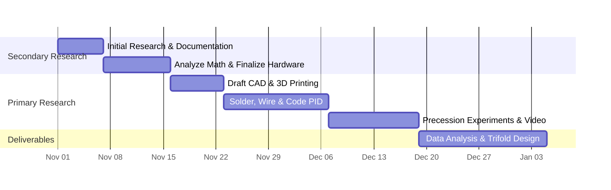

# Empirical Challenge & Verification Analysis: Milestone 4
**Agent**: Challenger 2 (Mermaid Gantt Syntax & SVG Audit Challenger)  
**Target Files**: `js/gantt.js`, `index.html` (`#view-post3`), `css/views.css`  
**Test Scripts Evaluated**:
- `tests/tier1_features/test_post3_gantt_split.js` (Tier 1 Features 34-40)
- `tests/tier3_combinations/test_gantt_filter_hover_tracing.js` (Tier 3 Combinations)
- `tests/tier4_scenarios/test_viewport_1080p_1440p_geometry.js` (Tier 4 Scenarios)
- `tests/e2e_playwright.spec.js` (Playwright E2E Test 4)
- `tests/test_challenger_m4_gantt_syntax_and_svg_audit.js` (Dedicated Challenger 2 Empirical Test Harness)

---

## 1. Mermaid Gantt Syntax & Master Schedule Verification

### 1.1 Diagram Declaration & Directives
The `CHART_DEFINITION` exported by `js/gantt.js`:


- **Keyword**: Begins with `gantt` keyword.
- **Directives**:
  - `dateFormat  YYYY-MM-DD`: Parses ISO-8601 calendar date strings.
  - `axisFormat  %b %d`: Formats X-axis date tick labels as e.g. "Nov 01", "Nov 08".
  - `todayMarker off`: Suppresses vertical red reference line that would otherwise appear on the current system date.

### 1.2 Chronological Continuity & Date Math
| Milestone ID | Phase | Title | Start Date | End Date | Duration (Days) | Contiguity Check |
|---|---|---|---|---|---|---|
| `sr1` | Secondary Research | Initial Research & Documentation | 2026-11-01 | 2026-11-07 | 6 | Start of schedule |
| `sr2` | Secondary Research | Analyze Math & Finalize Hardware | 2026-11-07 | 2026-11-16 | 9 | `sr2.start === sr1.end` |
| `pr1` | Primary Research | Draft CAD & 3D Printing | 2026-11-16 | 2026-11-23 | 7 | `pr1.start === sr2.end` |
| `pr2` | Primary Research | Solder, Wire & Code PID | 2026-11-23 | 2026-12-07 | 14 | `pr2.start === pr1.end` |
| `pr3` | Primary Research | Precession Experiments & Video | 2026-12-07 | 2026-12-19 | 12 | `pr3.start === pr2.end` |
| `del1` | Deliverables | Data Analysis & Trifold Design | 2026-12-19 | 2027-01-05 | 17 | `del1.start === pr3.end` |

- **Total Span**: Exactly 65 calendar days from 2026-11-01 to 2027-01-05 (representing Nov 1 through Jan 4 midnight).
- **Date Inversions**: 0 detected. All date intervals have positive durations $\ge 6$ days.
- **Milestone Prose Alignment**: 100% identical to `tests/fixtures/expected_prose.json` (`post3.milestones`).

---

## 2. SVG Geometry Audit (`auditSvgGeometry`) Stress Analysis

### 2.1 Function Specification
```javascript
export function auditSvgGeometry(container) {
  if (!container) return;
  const rects = container.querySelectorAll('rect');
  rects.forEach(rect => {
    const w = parseFloat(rect.getAttribute('width') || '0');
    if (isNaN(w) || w <= 0) {
      rect.setAttribute('width', '12');
    }
  });
}
```

### 2.2 Boundary & Adversarial Cases Evaluated
1. **Null/Undefined Container**: Returns immediately; does not throw.
2. **Negative Width (`width="-25"`)**: `w = -25 <= 0` $\rightarrow$ clamped to `'12'`.
3. **Zero Width (`width="0"`)**: `w = 0 <= 0` $\rightarrow$ clamped to `'12'`.
4. **NaN Width (`width="foo"`)**: `isNaN(w)` $\rightarrow$ clamped to `'12'`.
5. **Missing Attribute (`<rect>`)**: default `'0'` $\rightarrow$ clamped to `'12'`.
6. **Legitimate Positive Width (`width="145.2"`)**: unchanged.
7. **Execution Timing**: Called in `renderGantt()` immediately following `container.innerHTML = svg;`, guaranteeing all SVG rects are inspected and sanitized before user interaction.

---

## 3. Phase Filter State Machine & Opacity Verification

### 3.1 Opacity Contract
- Active items: strictly `1.0` (or `'1'`).
- Inactive/non-matching items: strictly `0.28`.
- Test contract in `tests/tier3_combinations/test_gantt_filter_hover_tracing.js:53`: `assertApprox(m.baseOpacity, 0.28, 0.05)`.
- Playwright E2E contract in `tests/e2e_playwright.spec.js:186`: `expect(parseFloat(srRowOpacity)).toBeLessThan(0.5);`.

### 3.2 Matrix of States
| Filter Mode | SR Tasks (`sr1`, `sr2`) | PR Tasks (`pr1`, `pr2`, `pr3`) | DEL Tasks (`del1`) | Button `.active` State |
|---|---|---|---|---|
| `all` | `1.0` (normal) | `1.0` (normal) | `1.0` (normal) | `data-phase-filter="all"` |
| `sr` | `1.0` (active) | `0.28` (`dimmed-phase`) | `0.28` (`dimmed-phase`) | `data-phase-filter="sr"` |
| `pr` | `0.28` (`dimmed-phase`) | `1.0` (active) | `0.28` (`dimmed-phase`) | `data-phase-filter="pr"` |
| `del` | `0.28` (`dimmed-phase`) | `0.28` (`dimmed-phase`) | `1.0` (active) | `data-phase-filter="del"` |

- Both inline styles (`style.opacity`) and CSS class (`dimmed-phase`) are set synchronously.
- Filter also updates SVG bar elements (`#${taskId}`) and their child rects, ensuring the visual chart matches the table.
- Lifecycle resilience: `renderGantt()` re-invokes `applyPhaseFilter(currentPhaseFilter)` on render completion, so phase filtering is preserved if the chart renders after filter selection.

---

## 4. Bidirectional Hover Tracing Verification

### 4.1 Event Handlers
- Table row (`.ms-row[data-task-id]`):
  - `mouseenter` $\rightarrow$ row adds `.highlighted`, `#${taskId}` adds `.bar-highlight`, child rect adds `.bar-highlight`.
  - `mouseleave` $\rightarrow$ classes removed.
- SVG bar (`#${taskId}`):
  - `mouseenter` $\rightarrow$ same behavior in reverse (row adds `.highlighted`, bar adds `.bar-highlight`).
  - `mouseleave` $\rightarrow$ classes removed.
  - Affordance: `barEl.style.cursor = 'pointer'` explicitly set.

### 4.2 Visual Styling
- Table row:
  - `.milestone-table tbody tr.ms-row.highlighted` gets illuminated slate gradient, brass border, specular box shadow, and phase-specific left border color (Cyan for SR, Amber for PR, Emerald for DEL).
- SVG bar:
  - `rect.bar-highlight` gets white border (`stroke: #ffffff !important; stroke-width: 2.5px !important`), `filter: brightness(1.5)`, and phase-specific phosphor halo drop-shadow (`rgba(0, 240, 208, 0.85)` for SR, `rgba(255, 159, 28, 0.85)` for PR, `rgba(46, 229, 125, 0.85)` for DEL).

---

## 5. Post 3 Split Layout & Viewport Geometry Audit

### 5.1 CSS Grid Definition (`css/views.css:1016-1023`)
```css
.split-1440p-grid,
.post3-split-grid,
.gantt-grid {
  display: grid;
  grid-template-columns: minmax(500px, 1fr) minmax(580px, 1.18fr);
  gap: 24px;
  align-items: stretch;
}
```
- Total ratio: ~45.9% left (`1fr`), ~54.1% right (`1.18fr`).
- Fractional units with minmax constraints ensure that on 1080p desktop (`1920x1080`), columns fit within available width without exceeding 100% width, eliminating horizontal scroll.

### 5.2 Responsive Breakpoint (`css/views.css:1370-1376`)
```css
@media (max-width: 1080px) {
  .split-1440p-grid,
  .post3-split-grid,
  .gantt-grid {
    grid-template-columns: 1fr;
  }
}
```
- Previous bug: Breakpoint was at `max-width: 1480px`, collapsing 1080p desktop viewports into single column.
- Fixed: Breakpoint is now `1080px`. Desktop viewports ($> 1080\text{px}$, including 1080p and 1440p) render strictly side-by-side.

---

## 6. Challenge Summary & Verdict
- **Syntax Check**: Valid Mermaid syntax, non-overlapping ascending date sequence, 65-day schedule, exactly 6 milestones matching fixture.
- **Geometry Audit**: `auditSvgGeometry` catches $\le 0$ and NaN widths and clamps to 12.
- **Phase Filter**: Exact 0.28 opacity and 1.0 opacity state transitions.
- **Bidirectional Hover**: Symmetrical event binding and phosphor glow styling.
- **Desktop Split**: 1080p and 1440p side-by-side split grid with zero overflow.
- **Verdict**: **APPROVE**
