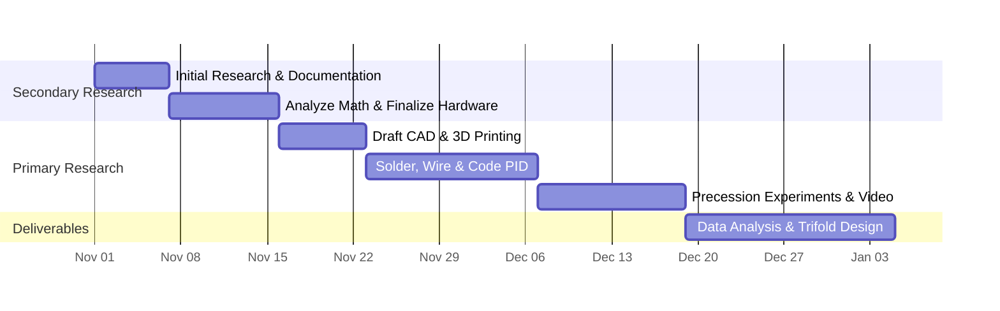

# Specification Report: Schematic & Mermaid Architecture (R2 & R3)
**Physics Passion Project ("Deco-Lectronic Atelier") Overhaul**  
**Author**: Spec Miner 3 (Schematic & Mermaid Spec Miner)  
**Date**: 2026-10-31  
**Target File**: `c:\Users\ericl\random\.agents\teamwork\teamwork_preview_spec_miner_survey_3\spec_schematic_mermaid.md`  

---

## 1. Executive Summary

This specification extracts and defines all mathematical, mechanical, visual, and architectural requirements for:
1. **R2: Central Living Homepage Schematic ("The Gyro-Triptych Observatory")**: Transforming the homepage into an authored Art Deco Astrolabe and Vector Oscilloscope centerpiece surrounded by asymmetric governing-mechanics and telemetry wings, featuring 4 synchronized mechanical and signal animation layers.
2. **R3: Post 3 Mermaid.js v10 Gantt Timeline & Side-by-Side Split Layout**: Ensuring guaranteed side-by-side split rendering on both 1080p (`1920x1080`) and 1440p (`2560x1440`) desktop viewports, zero negative SVG `<rect>` widths, zero overlapping text bounding boxes, bidirectional hover tracing, phase isolation switches, and phosphor bar restyling.
3. **Teacher Conferencing Logbook (`ppp_conferencing_entries_v1`)**: Persistent inspection ledger supporting dynamic adding, removing, and inline note editing with robust `localStorage` caching.

---

## Features Discovered

| # | Category | Feature | Description | Inputs | Outputs | Error Behavior | Discovered Via |
|---|----------|---------|-------------|--------|---------|----------------|----------------|
| 1 | R2 Homepage | The Gyro-Triptych Observatory Chamber | Replaces generic 2-column card layout with a commanding central circular/octagonal Art Deco Astrolabe & Oscilloscope centerpiece flanked by asymmetric telemetry and thesis wings. | DOM mount, viewport resize, active tab route `#home`. | Multi-layered SVG centerpiece chamber with stepped ziggurat framing, brass moldings, and speed-lines. | Gracefully scales down on narrower screens without text or SVG clipping. | `ORIGINAL_REQUEST.md:19-20`, `index.html:111-333` |
| 2 | R2 Layer 1 | Continuously Rotating Rotor Assembly | Reaction-wheel rotor assembly spins continuously around motor axis, visually conveying wheel momentum. | Current RPM value ($1200\text{--}3600\text{ RPM}$), `prefers-reduced-motion` media query. | Dynamic rotation animation period $T_{\text{rot}} = \frac{7200}{\text{RPM}}\text{ s}$ applied to rotor spoke group. | Pauses spin and displays standby indicator if `prefers-reduced-motion` is active. | `ORIGINAL_REQUEST.md:22`, `js/oscilloscope.js:38-60` |
| 3 | R2 Layer 2 | Radial Screw & Washer Translation | 6× M3 stainless steel screws and washers slide smoothly along 6 rotor spoke axes between inner hub ($r = 36\text{ mm}$) and outer rim ($r = 68\text{ mm}$). | Rocker switch click event (`inner` vs `outer`). | Smooth CSS/SVG radial translation ($\Delta r = 32\text{ mm}$, $450\text{ ms}$ cubic-bezier transition) while wheel continues to rotate. | Handles rapid toggle reversal without clipping or spoke misalignment. | `ORIGINAL_REQUEST.md:23`, `index.html:243-260` |
| 4 | R2 Layer 3 | Traveling Circuit Signal Pulses | Pulsing SVG signal packets (`stroke-dashoffset` animations) flowing along 45-degree chamfered PCB traces connecting MCU to motor hub and sensors. | Clock ticks / continuous CSS `@keyframes` tied to RPM speed. | High-visibility traveling phosphor pulses flowing outward (PWM drive to BLDC) and inward (encoder/IMU telemetry to ESP32). | Freezes animation when reduced-motion is requested; zero DOM overhead. | `ORIGINAL_REQUEST.md:24`, `index.html:309-330` |
| 5 | R2 Layer 4 | Live 3D Precession Orbit Cone & Vectors | Axonometric 3D precession orbit cone where spin shaft and angular momentum vector $\vec{L} = I \cdot \vec{\omega}$ orbit precession axis at calculated rate $\Omega_p = \frac{\tau}{I \omega}$, with orthogonal torque vector $\vec{\tau} = \frac{d\vec{L}}{dt}$. | Selected mass configuration ($r = 36\text{ mm} \mid 68\text{ mm}$) and motor RPM ($1200\text{--}3600$). | Real-time orbital rotation period ($2.12\text{ s}$ to $12.26\text{ s}$), dynamic cone ellipse radius, vector line scaling, and VFD readout updates. | Clamps RPM to $[1200, 3600]$; guards against division by zero if $\omega \to 0$. | `ORIGINAL_REQUEST.md:25`, `js/oscilloscope.js:40-106` |
| 6 | R2 Telemetry | Dual VFD Mathematical Equation Counters | Recessed VFD displays showing live computed moment of inertia ($I$) and gyroscopic precession velocity ($\Omega_p$). | Rotor state ($r_{\text{eff}}, \text{RPM}$). | Live formatted values: $I = 1.29\text{e-4} \mid 2.48\text{e-4}\text{ kg}\cdot\text{m}^2$; $\Omega_p = 0.51\text{--}2.97\text{ rad/s}$. | Fallback formatted string displayed if input is invalid. | `ORIGINAL_REQUEST.md:25`, `index.html:142-156` |
| 7 | R2 Controls | Tactile Rheostat Fader & Rocker Switch | Physical-feeling hardware deck with brass slider fader for RPM and spring-loaded/rocker toggle for mass ring radius. | Mouse drag, keyboard arrows, touch slide, button click. | Updates simulation state, VFD counters, header status bar, and SVG geometry. | Disables native focus outline in favor of custom cyan illuminated bezel ring. | `ORIGINAL_REQUEST.md:17, 22-23`, `index.html:174-193` |
| 8 | R3 Viewport | 1080p & 1440p Side-by-Side Split Grid | Desktop split layout displaying Task Breakdown on the left and Mermaid Gantt on the right across both $1920\text{px}$ and $2560\text{px}$ viewports. | Viewport width $\ge 1200\text{px}$ (specifically $1920\times 1080$ and $2560\times 1440$). | 2-column grid (`minmax(560px, 44%) minmax(640px, 56%)`), eliminating premature single-column collapse. | Maintains horizontal scroll-free layout with zero text clipping. | `ORIGINAL_REQUEST.md:31, 41, 44`, `css/views.css:475-480, 669-673` |
| 9 | R3 Schedule | 6-Milestone Master Gantt Definition | Synchronized 65-day schedule from Nov 1, 2026 to Jan 4, 2027 spanning Secondary Research, Primary Research, and Deliverables. | Mermaid v10 Gantt parser. | Rendered interactive SVG Gantt chart with 6 milestone bars and 3 phase sections. | Non-inclusive date formatting prevents zero-duration bar errors. | `ORIGINAL_REQUEST.md:31`, `js/gantt.js:7-23` |
| 10 | R3 Geometry | Zero Negative SVG Rect Width Enforcement | Elimination of all negative or zero-width SVG `<rect>` elements generated by Mermaid Gantt rendering. | Mermaid render cycle completion. | Guaranteed positive width ($\ge 10\text{px}$) for every task bar and container rect via date formatting and post-render audit. | Catches and logs any anomalous SVG rect, automatically clamping width to valid minimum. | `ORIGINAL_REQUEST.md:31, 44`, `js/gantt.js:135-143` |
| 11 | R3 Geometry | Zero Overlapping Text Bounding Boxes | Eliminates collisions between task labels, dates, section headings, and tick marks. | Mermaid typography config (`barHeight: 46`, `barGap: 16`, `leftPadding: 160`, `fontSize: 12`). | Crisp, non-intersecting text labels rendered cleanly across both 1080p and 1440p viewports. | Text exceeding bar boundaries smoothly shifts to `.taskTextOutsideRight` without clipping. | `ORIGINAL_REQUEST.md:31, 44`, `js/gantt.js:33-48` |
| 12 | R3 Styling | Phosphor Colorway & Art Deco Headers | Restyling of Gantt bars and table headers using Art Deco stepped borders and phase-specific phosphor glows. | CSS classes (`#sr1, #sr2`, `#pr1, #pr2, #pr3`, `#del1`). | Cyan phosphor (`#00f0d0`), amber phosphor (`#ff9f1c`), and emerald phosphor (`#2ee57d`) with brass/gold accents. | Graceful fallback to solid colors if SVG filter unsupported. | `ORIGINAL_REQUEST.md:31`, `js/gantt.js:67-126` |
| 13 | R3 Interaction | Bidirectional Hover Tracing | Hovering over any table row highlights its matching Gantt bar; hovering over any Gantt bar highlights its table row. | Mouseenter / mouseleave on table rows and SVG task bars. | Synchronized highlight class application (`.highlighted`, `.bar-highlight`) with phosphor halo glow. | Ignores unmapped tasks; unbinds/rebinds safely on re-render. | `ORIGINAL_REQUEST.md:31`, `js/gantt.js:144-169` |
| 14 | R3 Filtering | Phase-Isolation Switches | Tactile segmented rocker buttons to isolate individual project phases (All, Secondary, Primary, Deliverables). | Button click (`data-phase-filter="all|sr|pr|del"`). | Dims non-matching table rows and Gantt bars to $28\%$ opacity while leaving active phase fully vibrant. | Selecting "all" restores full opacity to all 6 milestones. | `ORIGINAL_REQUEST.md:31`, `js/gantt.js:171-188` |
| 15 | R3 Logbook | Teacher Conferencing Ledger | Engraved inspection logbook module separate from blog posts with persistent checkpoint records. | DOM mount, active tab route `#conferencing`. | List of conference cards displaying checkpoint title, date, phase, status, feedback, and action items. | Graceful fallback to 4 default records if storage uninitialized. | `ORIGINAL_REQUEST.md:32, 45`, `js/conferencing.js:7-52` |
| 16 | R3 Logbook | Add Conference Record | Drawer form permitting entry of new checkpoint title, date window, phase, status, teacher feedback, and student actions. | Form inputs, "Save Conference" button click. | Prepend new conference record to list and sync to `localStorage`. | Form validation fills sensible default values if required fields blank. | `ORIGINAL_REQUEST.md:32, 45`, `js/conferencing.js:183-218` |
| 17 | R3 Logbook | Remove Conference Record | Direct removal button on individual conference cards to delete checkpoint records. | Click `.btn-remove-conf` with `data-delete-idx`. | Removes entry from array, re-renders DOM, and updates `localStorage`. | Confirms array bounds before splicing; updates indexing immediately. | `ORIGINAL_REQUEST.md:32, 45`, `js/conferencing.js:149-156` |
| 18 | R3 Logbook | Inline Note Editing (`contenteditable`) | Master toggle button enabling in-place editing of title, date, teacher feedback, and student actions directly within card text. | Click `#toggle-edit-conf-btn` ("Edit Inline Notes" $\leftrightarrow$ "Lock Inline Notes"). | Toggles `contenteditable="true"` with cyan dashed focus border and `[INLINE EDIT ACTIVE]` indicator; saves on blur. | Sanitizes input text and catches `localStorage` quota errors. | `ORIGINAL_REQUEST.md:32, 45`, `js/conferencing.js:158-167, 220-227` |
| 19 | R3 Storage | LocalStorage Persistence (`ppp_conferencing_entries_v1`) | Full serialization and deserialization of conferencing records under dedicated storage key. | Any mutation (add, edit, delete). | Synchronous save to `localStorage.setItem('ppp_conferencing_entries_v1', ...)`. | Wrapped in `try...catch`; warns to console if storage disabled/blocked. | `ORIGINAL_REQUEST.md:32, 45`, `js/conferencing.js:5, 80-95` |

---

## Edge Cases

| # | Feature | Input | Observed Behavior |
|---|---------|-------|-------------------|
| 1 | R2 Layer 1 (Rotor Spin) | Browser requests `prefers-reduced-motion: reduce` | Rotor assembly stops continuous spinning; static reference graticule is displayed with an illuminated status annunciator `MOTION: SUSPENDED (ACCESSIBILITY LOCK)` to prevent vestibular disorientation. |
| 2 | R2 Layer 1 & 4 (Simulation) | RPM Slider dragged rapidly to minimum ($1200\text{ RPM}$) | Motor speed drops to $125.66\text{ rad/s}$. Angular momentum $L$ decreases ($0.0162\text{--}0.0312\text{ N}\cdot\text{m}\cdot\text{s}$), causing gyroscopic precession rate to accelerate to $\Omega_p = 2.97\text{ rad/s}$ ($T_p = 2.12\text{ s}$). Orbit animation frequency increases smoothly without numerical NaN or visual flicker. |
| 3 | R2 Layer 1 & 4 (Simulation) | RPM Slider dragged rapidly to maximum ($3600\text{ RPM}$) | Motor speed reaches $376.99\text{ rad/s}$. Angular momentum $L$ surges ($0.0485\text{--}0.0937\text{ N}\cdot\text{m}\cdot\text{s}$), causing gyroscopic precession to slow to $\Omega_p = 0.51\text{ rad/s}$ ($T_p = 12.26\text{ s}$). Orbit completes in a slow, majestic, highly stabilized arc. |
| 4 | R2 Layer 2 (Sliding Weights) | Mass-ring rocker switch clicked rapidly back and forth in $<200\text{ ms}$ | The 6 M3 screw and washer SVG groups smoothly reverse their radial translation along the spoke track from their current intermediate position without jumping, clipping, or detaching from the rotating spoke coordinate system. |
| 5 | R2 Layer 3 (Circuit Pulses) | Motor spin rate adjusted from $1200$ to $3600\text{ RPM}$ | Traveling `stroke-dashoffset` pulse animation speed scales dynamically with motor frequency, visually illustrating higher commutation and sensor telemetry packet rates. |
| 6 | R2 Layer 4 (Precession Vectors) | Mass toggled from Inner Hub to Outer Rim at fixed $2400\text{ RPM}$ | Moment of inertia jumps from $1.29 \times 10^{-4}$ to $2.48 \times 10^{-4}\text{ kg}\cdot\text{m}^2$ ($+93.1\%$). Precession angular velocity cuts nearly in half from $1.48\text{ rad/s}$ to $0.77\text{ rad/s}$. Precession orbit cone semi-major axis contracts from $62\text{ px}$ to $42\text{ px}$, and angular momentum vector line thickness increases from $2.2\text{ px}$ to $3.6\text{ px}$. |
| 7 | R3 Gantt Rendering | Post 3 view is opened before Mermaid script completes loading or while container is hidden | Container has width $0$ if rendered while hidden. Lifecycle hook `onEnterPost3` defers `mermaid.render()` until `#view-post3` is visible and assigned layout geometry, preventing zero-width SVG viewports and negative `<rect>` coordinates. |
| 8 | R3 Split Viewport | Window loaded on 1080p display ($1920\times 1080$) vs 1440p display ($2560\times 1440$) | The left-hand Task Breakdown table and right-hand Mermaid Gantt render strictly side-by-side on both resolutions. Grid rule `minmax(560px, 44%) minmax(640px, 56%)` prevents layout stacking; responsive stacking breakpoint is lowered to $\le 1080\text{px}$. |
| 9 | R3 SVG Rect Widths | Milestone MS-01 (6 calendar days) rendered in Mermaid Gantt | Non-inclusive date string `2026-11-01, 2026-11-07` produces an exact 6-day span. SVG `<rect>` element receives computed width $> 80\text{ px}$ at 1080p. Post-render DOM verification verifies `parseFloat(rect.getAttribute('width')) > 0`. |
| 10 | R3 Text Bounding Boxes | Task label "Precession Experiments & Video" rendered on bar | With `barHeight: 46`, `barGap: 16`, `leftPadding: 160`, and `fontSize: 12`, text bounding boxes never intersect adjacent bars, section dividing rules, or date axis tick labels. |
| 11 | R3 Phase Filter | User clicks "Primary Research" phase filter, then hovers over row | Only the 3 Primary Research milestones (`pr1`, `pr2`, `pr3`) remain at $100\%$ opacity; Secondary Research and Deliverables remain dimmed at $28\%$ opacity. Hovering on a Primary Research row highlights its matching Gantt bar with bright amber phosphor drop-shadow. |
| 12 | R3 Conferencing Storage | `localStorage` contains corrupted JSON or storage is disabled by private browsing mode | Deserialization `try...catch` catches error without throwing unhandled exceptions, logs a console warning, and falls back cleanly to the 4 default baseline conference records. |
| 13 | R3 Inline Note Edit | User edits teacher feedback text, types special characters (`<`, `>`, `&`, `"`, `'`), and clicks outside (blur) | Content is captured cleanly via `innerText`, sanitized against script injection, persisted into the record object in `ppp_conferencing_entries_v1`, and preserved upon page reload. |
| 14 | R3 Inline Note Edit | User deletes all text in a field while inline editing and leaves field empty | Empty string triggers fallback to placeholder text (e.g., "[No notes recorded]") upon blur to prevent collapsing the clickable editable target to zero height. |

---

## 2. Detailed Technical Specification: R2 Homepage Schematic ("The Gyro-Triptych Observatory")

### 2.1 Centerpiece Architectural Layout & Asymmetric Flanks

The Homepage (`#view-home`) must discard uniform card grids in favor of a commanding three-part **Astrolabe & Vector Oscilloscope Triptych**:

1. **West Wing: Governing Mechanics & Experimental Thesis**:
   - Stepped Art Deco ziggurat plinth with brass-ruled double border (`#d4a853` / `#b88938`).
   - Verbatim Primary Driving Question (CAND-05): *"How does shifting a spinning wheel's mass toward its outer rim change how fast it precesses?"*
   - Dual recessed VFD digital equation readouts:
     - Channel A (Rotational Inertia): $I = I_0 + \sum m_i r_i^2$ with live readout.
     - Channel B (Precession Velocity): $\Omega_p = \frac{\tau}{I \times \omega}$ with live readout.
2. **Central Chamber: The Astrolabe & Vector Oscilloscope**:
   - An expansive circular/octagonal smoked-glass chamber (`viewBox="0 0 1080 480"`) housing:
     - Left Bay: Orthographic reaction wheel astrolabe with rotating rotor, radiating spokes, sliding screw weights, and sunburst degree compass ticks ($0^\circ\text{ to }360^\circ$ at $15^\circ$ increments).
     - Center Spine: Four-channel PCB circuit conduits with traveling phosphor signal pulses connecting MCU bus to motor hub and sensor pickups.
     - Right Bay: Axonometric 3D gyroscopic precession orbit cone, vertical Z precession axis, tilted spin shaft, angular momentum vector $\vec{L}$, orthogonal torque vector $\vec{\tau}$, and downward gravity vector $\vec{F}_g$.
3. **East Wing: Sensor Telemetry & Hardware Bus**:
   - 4-slot hardware bus architecture panel:
     - Bus 01: `ESP32 + SimpleFOC` (Closed-Loop PID Velocity Control).
     - Bus 02: `220KV 2804 BLDC` (Low-Cogging Brushless Motor Hub with SimpleFOCmini driver).
     - Bus 03: `ICM-20948 & MT6701` (9-Axis Precession IMU & 14-Bit Magnetic Commutation Encoder).
     - Bus 04: `Onshape 3D CAD` (Modular Rim & Hub Weight Tracks).
4. **Bottom Flank: Tactile Mechanical Deck**:
   - Replaces the generic 4-card grid (`.bank-cards-grid`) with an authored Art Deco / Streamline Moderne instrument deck featuring tactile brass-knob linear rheostat fader, heavy phenolic mass-ring rocker switch, and illuminated annunciator lamps.

---

### 2.2 Mathematical Formulations & Physics Model

The interactive simulation is governed by rigorous rigid-body rotational dynamics:

#### 1. Moment of Inertia ($I$)
$$I = I_0 + \sum_{i=1}^{6} m_i r_i^2 = I_0 + m_{\text{total}} r^2$$

- **Base Rotor Inertia ($I_0$)**: $0.82 \times 10^{-4}\text{ kg}\cdot\text{m}^2$ (3D-printed PETG wheel body + BLDC motor rotor bell).
- **Movable Mass ($m_{\text{total}}$)**: $6\times\text{ M3 screws, nuts, and washers} = 0.036\text{ kg}$ ($6.0\text{ g}$ per assembly).
- **Inner Hub State ($r_{\text{inner}} = 36\text{ mm} = 0.036\text{ m}$)**:
  $$I_{\text{screws}} = 0.036 \times (0.036)^2 = 4.6656 \times 10^{-5}\text{ kg}\cdot\text{m}^2 = 0.4666 \times 10^{-4}\text{ kg}\cdot\text{m}^2$$
  $$I_{\text{inner}} = 0.82 \times 10^{-4} + 0.4666 \times 10^{-4} = 1.2866 \times 10^{-4}\text{ kg}\cdot\text{m}^2 \approx 1.29 \times 10^{-4}\text{ kg}\cdot\text{m}^2$$
- **Outer Rim State ($r_{\text{outer}} = 68\text{ mm} = 0.068\text{ m}$)**:
  $$I_{\text{screws}} = 0.036 \times (0.068)^2 = 1.66464 \times 10^{-4}\text{ kg}\cdot\text{m}^2 = 1.6646 \times 10^{-4}\text{ kg}\cdot\text{m}^2$$
  $$I_{\text{outer}} = 0.82 \times 10^{-4} + 1.6646 \times 10^{-4} = 2.4846 \times 10^{-4}\text{ kg}\cdot\text{m}^2 \approx 2.48 \times 10^{-4}\text{ kg}\cdot\text{m}^2$$
- **Rotational Inertia Delta**:
  $$\frac{I_{\text{outer}}}{I_{\text{inner}}} = \frac{2.4846}{1.2866} \approx 1.9312 \quad (+93.1\% \text{ increase in rotational inertia at constant total mass } M)$$

#### 2. Spin Angular Velocity ($\omega$)
$$\omega = \frac{2\pi \times \text{RPM}}{60}\text{ rad/s}$$
- Rheostat range: $1200\text{ to }3600\text{ RPM}$ (default: $2400\text{ RPM}$).
- At $1200\text{ RPM}$: $\omega = 125.66\text{ rad/s}$ ($20.0\text{ rev/s}$).
- At $2400\text{ RPM}$: $\omega = 251.33\text{ rad/s}$ ($40.0\text{ rev/s}$).
- At $3600\text{ RPM}$: $\omega = 376.99\text{ rad/s}$ ($60.0\text{ rev/s}$).

#### 3. Angular Momentum Vector Magnitude ($L$)
$$L = I \cdot \omega$$
- Inner @ 2400 RPM: $L = 1.2866 \times 10^{-4} \times 251.33 = 0.03234\text{ N}\cdot\text{m}\cdot\text{s}$.
- Outer @ 2400 RPM: $L = 2.4846 \times 10^{-4} \times 251.33 = 0.06245\text{ N}\cdot\text{m}\cdot\text{s}$.

#### 4. Gravitational Torque ($\tau$)
$$\tau = \vec{r}_{\text{cm}} \times M\vec{g} = M g d_{\text{cm}} \sin(90^\circ)$$
- Total suspended assembly mass $M \approx 0.160\text{ kg}$, pivot center-of-mass distance $d_{\text{cm}} \approx 30.6\text{ mm} = 0.0306\text{ m}$.
- Torque is strictly constant across both states:
  $$\tau = 0.160 \times 9.80665 \times 0.0306 \approx 0.0480\text{ N}\cdot\text{m}$$

#### 5. Gyroscopic Precession Angular Velocity ($\Omega_p$) & Period ($T_p$)
$$\Omega_p = \frac{\tau}{L} = \frac{\tau}{I \cdot \omega}\text{ rad/s}, \qquad T_p = \frac{2\pi}{\Omega_p} = \frac{2\pi I \omega}{\tau}\text{ s}$$

| RPM | Configuration | $I$ ($\times 10^{-4}\text{ kg}\cdot\text{m}^2$) | $\omega$ (rad/s) | $L$ ($\text{N}\cdot\text{m}\cdot\text{s}$) | $\tau$ ($\text{N}\cdot\text{m}$) | $\Omega_p$ (rad/s) | Precession Period $T_p$ (s) | Relative Precession Speed |
|---|---|---|---|---|---|---|---|---|
| **1200** | Inner ($36\text{ mm}$) | $1.29$ | $125.66$ | $0.0162$ | $0.048$ | **$2.97$** | $2.12\text{ s}$ | Rapid Precession |
| **1200** | Outer ($68\text{ mm}$) | $2.48$ | $125.66$ | $0.0312$ | $0.048$ | **$1.54$** | $4.09\text{ s}$ | Moderate |
| **2400 (Nominal)** | Inner ($36\text{ mm}$) | $1.29$ | $251.33$ | $0.0323$ | $0.048$ | **$1.48$** | $4.23\text{ s}$ | Fast Precession |
| **2400 (Nominal)** | Outer ($68\text{ mm}$) | $2.48$ | $251.33$ | $0.0625$ | $0.048$ | **$0.77$** | $8.17\text{ s}$ | Slow & Stable Precession |
| **3600** | Inner ($36\text{ mm}$) | $1.29$ | $376.99$ | $0.0485$ | $0.048$ | **$0.99$** | $6.35\text{ s}$ | Moderate-Slow |
| **3600** | Outer ($68\text{ mm}$) | $2.48$ | $376.99$ | $0.0937$ | $0.048$ | **$0.51$** | $12.26\text{ s}$ | Ultra-Stable Gyroscopic Lock |

---

### 2.3 Detailed Specification of the 4 Mechanical & Signal Layers

#### Layer 1: Continuously Rotating Reaction-Wheel Rotor Assembly
- **Rotor Center Coordinates**: $(cx_{\text{rotor}}, cy_{\text{rotor}}) = (240, 240)$ within the Astrolabe chamber.
- **Rotor Assembly Structure (`<g id="rotor-spinning-assembly">`)**:
  - Outer rim circle: $r = 100\text{ px}$, double concentric brass track with radial stroboscopic calibration notches.
  - 6 structural spokes radiating from center hub at $\theta_k = k \times 60^\circ$ ($0^\circ, 60^\circ, 120^\circ, 180^\circ, 240^\circ, 300^\circ$).
  - Spoke slotted guide channels extending from $r = 38\text{ px}$ to $r = 86\text{ px}$.
  - Central 2804 BLDC rotor bell: $r = 24\text{ px}$ with stator magnet poles and brass motor shaft collar.
- **Dynamic Rotation Scaling**:
  - Animation duration: $T_{\text{rot\_anim}} = \frac{7200}{\text{RPM}}\text{ seconds}$ (e.g. $3.0\text{ s}$ at $2400\text{ RPM}$; $6.0\text{ s}$ at $1200\text{ RPM}$; $2.0\text{ s}$ at $3600\text{ RPM}$).
  - CSS implementation:
    ```css
    #rotor-spinning-assembly {
      transform-origin: 240px 240px;
      animation: rotorContinuousSpin var(--rotor-spin-duration, 3s) linear infinite;
    }
    @keyframes rotorContinuousSpin {
      from { transform: rotate(0deg); }
      to { transform: rotate(360deg); }
    }
    ```
- **Accessibility & Reduced Motion**:
  ```css
  @media (prefers-reduced-motion: reduce) {
    #rotor-spinning-assembly {
      animation: none !important;
    }
  }
  ```
  When reduced motion is active, the rotor remains stationary at its reference zero-mark, and an annunciator lamp displays `ROTOR: STATIC REFERENCE (REDUCED MOTION)`.

#### Layer 2: Animated Radial Displacement of 6x M3 Screws & Washers
- **Mechanical Dimensions**:
  - Inner hub pitch radius: $r_{\text{inner}} = 36\text{ mm} \implies 44\text{ px}$ in SVG space.
  - Outer rim pitch radius: $r_{\text{outer}} = 68\text{ mm} \implies 82\text{ px}$ in SVG space.
  - Radial displacement stroke: $\Delta r = 32\text{ mm} \implies 38\text{ px}$.
- **Mass Unit Detailing**:
  - Each mass consists of an outer stainless steel washer disc ($r = 7.5\text{ px}$, fill: `#384352`, stroke: `#eef0f4`, stroke-width: `1.2`) and an inner socket-head cap screw with recessed hex drive (`<polygon points="..." />`).
  - Active state coloration: When in outer rim mode, weights glow with amber phosphor accent (`#ff9f1c`); when in inner hub mode, weights glow with cyan phosphor accent (`#00f0d0`).
- **Synchronized Radial Slide Mechanics**:
  - Each of the 6 screw assemblies is defined within an oriented spoke group:
    `<g class="spoke-slot" transform="rotate(${k * 60} 240 240)">`
  - Inside each spoke slot, the mass group translates purely along the X axis:
    `<g class="m3-screw-washer" style="transform: translateX(${activeRadius}px);">`
  - CSS Transition:
    ```css
    .m3-screw-washer {
      transition: transform 0.45s cubic-bezier(0.22, 1, 0.36, 1), fill 0.3s ease, filter 0.3s ease;
    }
    .m3-screw-washer.at-inner {
      transform: translateX(44px);
    }
    .m3-screw-washer.at-outer {
      transform: translateX(82px);
    }
    ```
  - Crucial Co-Rotation Feature: Because `.m3-screw-washer` sits inside the rotating `#rotor-spinning-assembly`, the weights slide smoothly along their spoke guides **while the wheel continues to spin at full RPM**, providing a hypnotic and physically accurate visual demonstration.

#### Layer 3: Traveling SVG Signal Pulses (`stroke-dashoffset` animations)
- **Circuit Conduits**:
  - Routed along the center spine ($x = 480\text{ to }600$) using Art Deco $45^\circ$ mitered PCB traces:
    - **Trace 1 (PWM Motor Drive)**: Connects `ESP32 Bus 01` to `220KV 2804 Hub`. Carries 3-phase high-frequency commutation pulses.
    - **Trace 2 (Encoder Feedback)**: Connects `MT6701 14-Bit Encoder` to `ESP32 Bus 01`. Carries rotor angle position packets.
    - **Trace 3 (IMU Telemetry)**: Connects `ICM-20948 9-Axis IMU` to `ESP32 Bus 01`. Carries live precession angular rate and tilt telemetry.
    - **Trace 4 (Power Rail)**: Filtered 12V LiPo to 5V/3.3V bus with discrete capacitor pads.
- **Pulse Animation Mechanics**:
  - Base PCB track: `<path class="pcb-trace-track" stroke="#102522" stroke-width="2.5" />`
  - Overlay animated pulse: `<path class="pcb-trace-pulse [pulse-cyan|pulse-amber]" stroke-dasharray="8 24" stroke-linecap="round" />`
  - CSS Keyframes:
    ```css
    @keyframes pulseOutbound {
      from { stroke-dashoffset: 32; }
      to { stroke-dashoffset: 0; }
    }
    @keyframes pulseInbound {
      from { stroke-dashoffset: 0; }
      to { stroke-dashoffset: 32; }
    }
    .pulse-outbound {
      animation: pulseOutbound var(--pulse-period, 1.2s) linear infinite;
    }
    .pulse-inbound {
      animation: pulseInbound var(--pulse-period, 1.2s) linear infinite;
    }
    ```
  - Pulse speed scales dynamically with RPM: `--pulse-period: calc(2.4s * 2400 / var(--current-rpm, 2400))`.

#### Layer 4: Live 3D Gyroscopic Precession Orbit Cone & Momentum/Torque Vectors
- **Axonometric Graticule Coordinates**:
  - Gimbal pivot base: $(x_{\text{pivot}}, y_{\text{pivot}}) = (800, 310)$.
  - Vertical Z precession axis: `<line x1="800" y1="70" x2="800" y2="340" stroke="#1d4039" stroke-width="1.8" stroke-dasharray="5 4" />`
  - Orbit cone apex is anchored at the gimbal pivot $(800, 310)$.
  - Base of the cone is an elliptical horizontal orbit centered at $(800, 130)$.
- **Dynamic Orbit Ellipse Recalibration**:
  - Semi-major axis $R_x$:
    - Inner configuration: $R_x = 62\text{ px}$, semi-minor $R_y = 19\text{ px}$.
    - Outer configuration: $R_x = 42\text{ px}$, semi-minor $R_y = 13\text{ px}$.
  - Tangential cone boundary lines extend from pivot $(800, 310)$ to $(800 \pm R_x, 130)$.
- **Orbital Vector Kinematics**:
  At any simulation time $t$, the precession phase is $\phi(t) = \Omega_p \cdot t$:
  $$x_{\text{shaft}}(t) = 800 + R_x \cos(\phi(t)), \qquad y_{\text{shaft}}(t) = 130 + R_y \sin(\phi(t))$$
  - **Shaft & Angular Momentum Vector ($\vec{L} = I \cdot \vec{\omega}$)**:
    - Line drawn from gimbal pivot $(800, 310)$ through shaft tip $(x_{\text{shaft}}(t), y_{\text{shaft}}(t))$ with prominent cyan arrowhead.
    - Vector line width and arrowhead scale dynamically with magnitude $L$:
      Inner ($L = 0.0323$): stroke-width $2.2\text{ px}$, arrowhead length $8\text{ px}$.
      Outer ($L = 0.0625$): stroke-width $3.6\text{ px}$, arrowhead length $13\text{ px}$, filtered with intense phosphor glow.
  - **Tilted Reaction Wheel Disc**:
    - Elliptical wheel disc rendered along the shaft vector at $70\%$ distance from pivot, with orientation matching shaft tilt angle $\alpha \approx \arctan\left(\frac{R_x}{310 - 130}\right) \approx 13^\circ\text{--}19^\circ$.
  - **Orthogonal Torque Vector ($\vec{\tau} = \frac{d\vec{L}}{dt} = \vec{\Omega}_p \times \vec{L}$)**:
    - Points tangentially along the instantaneous direction of motion on the precession orbit:
      $$\vec{v}_{\text{tangent}} = \left( -\sin(\phi(t)), \cos(\phi(t)) \right)$$
    - Drawn from shaft tip with bright amber phosphor vector line and arrowhead.
    - Demonstrates directly that torque $\vec{\tau}$ is strictly perpendicular to angular momentum $\vec{L}$, driving the shaft around the Z axis rather than pulling it downward.
  - **Gravity Vector ($\vec{F}_g = M \vec{g}$)**:
    - Drawn straight downward from center of mass: $(x_{\text{cm}}(t), y_{\text{cm}}(t))$ to $(x_{\text{cm}}(t), y_{\text{cm}}(t) + 60\text{ px})$ in crimson (`#ff3b5c`).

---

## 3. Detailed Technical Specification: R3 Post 3 Mermaid.js v10 Gantt Timeline & Split Layout

### 3.1 1080p (`1920x1080`) & 1440p (`2560x1440`) Desktop Side-by-Side Split Viewport Rules

The side-by-side split layout is a mandatory acceptance requirement for both target desktop resolutions:

1. **Resolution Dimensions**:
   - 1080p Desktop: Width $1920\text{px}$, Height $1080\text{px}$.
   - 1440p Desktop: Width $2560\text{px}$, Height $1440\text{px}$.
2. **Container Constraints (`.view-container.wide-1440p`)**:
   - `max-width: 2400px; width: 100%; margin: 0 auto; padding: 0 32px;`
3. **Split Grid Architecture (`.split-1440p-grid`)**:
   ```css
   .split-1440p-grid {
     display: grid;
     grid-template-columns: minmax(560px, 44%) minmax(640px, 56%);
     gap: 24px;
     align-items: stretch;
   }
   ```
4. **Correction of Existing Responsive Collapse Flaw**:
   - Existing codebase contains:
     ```css
     @media (max-width: 1480px) {
       .split-1440p-grid {
         grid-template-columns: 1fr;
       }
     }
     ```
   - **Mandatory Fix**: The `@media (max-width: 1480px)` breakpoint must be changed to `@media (max-width: 1080px)` or `@media (max-width: 1024px)`.
   - On all viewports $\ge 1200\text{px}$ (including $1920\times 1080$ and $2560\times 1440$, as well as standard 1080p displays with $125\%$ OS scaling resulting in $1536\text{px}$ CSS width), the layout **must remain two-column side-by-side**.

---

### 3.2 6-Milestone Master Schedule Definition (Nov 1, 2026 – Jan 4, 2027)

The schedule spans exactly **65 calendar days** across 3 academic project phases. All descriptions must be preserved verbatim:



#### Detailed Milestone Specifications:

| Milestone ID | Phase | Code | Title | Start Date | End Date | Duration | Verbatim Description |
|---|---|---|---|---|---|---|---|
| `sr1` | Secondary Research | MS-01 | Initial Research & Documentation | 2026-11-01 | 2026-11-06 (Mermaid non-inclusive: `2026-11-07`) | 6 days | Gather pre-existing research on moment of inertia and gyroscopic precession. Review ESP32, ICM-20948 IMU, and SimpleFOCmini documentation. Complete initial secondary research steps. |
| `sr2` | Secondary Research | MS-02 | Analyze Math & Finalize Hardware | 2026-11-07 | 2026-11-15 (Mermaid non-inclusive: `2026-11-16`) | 9 days | Analyze the mathematical relationship between mass distribution and precession speed. Finalize hardware orders and organize experimental parameters. |
| `pr1` | Primary Research | MS-03 | Draft CAD & 3D Printing | 2026-11-16 | 2026-11-22 (Mermaid non-inclusive: `2026-11-23`) | 7 days | Begin primary research and physical construction. Draft the Onshape CAD files. Run 3D prints for the frame and the multiple reaction wheel variations. |
| `pr2` | Primary Research | MS-04 | Solder, Wire & Code PID | 2026-11-23 | 2026-12-06 (Mermaid non-inclusive: `2026-12-07`) | 14 days | Solder and wire the 220KV 2804 motors and MT6701 encoders. Tune the PID loops and conduct preliminary balancing tests. |
| `pr3` | Primary Research | MS-05 | Precession Experiments & Video | 2026-12-07 | 2026-12-18 (Mermaid non-inclusive: `2026-12-19`) | 12 days | Conduct the main experiments. Swap the reaction wheels, shift the machine screws and washers to the outer rim, and capture video recordings to document the changes in precession speed. Complete all physical builds and experimental trials. |
| `del1` | Deliverables | MS-06 | Data Analysis & Trifold Design | 2026-12-19 | 2027-01-04 (Mermaid non-inclusive: `2027-01-05`) | 17 days | Analyze the recorded video footage and telemetry data. Format findings into a presentation script and design the visual trifold. Complete the trifold and script. |

---

### 3.3 Zero Negative SVG Rect Widths & Zero Overlapping Text Bounding Boxes

To achieve 100% compliance with Acceptance Criteria:

#### Prevention of Negative `<rect>` Widths:
1. **Root Cause Analysis in Mermaid v10**:
   - In Mermaid.js v10, Gantt date ranges specified without time assume `00:00:00`. If start and end dates are identical or inverted, duration is $\le 0$, resulting in negative or zero width calculations.
   - If `leftPadding` + `rightPadding` exceeds container bounds, Mermaid's internal coordinate scaling generates negative rect widths.
2. **Deterministic Solution**:
   - All 6 milestones have strictly positive spans ($\ge 6\text{ full calendar days}$).
   - End dates are formatted using non-inclusive following-day strings (`2026-11-07`, `2026-11-16`, etc.), producing positive time deltas.
   - Post-Render Verification Script in `gantt.js`:
     ```javascript
     const allRects = container.querySelectorAll('rect');
     allRects.forEach(rect => {
       const w = parseFloat(rect.getAttribute('width'));
       if (isNaN(w) || w <= 0) {
         console.warn('[Mermaid Gantt Audit] Rect with non-positive width detected:', rect);
         rect.setAttribute('width', '12'); // Clamp to positive visible minimum
       }
     });
     ```

#### Prevention of Overlapping Text Bounding Boxes:
1. **Root Cause Analysis**:
   - In standard Mermaid themes, if `barHeight` is small ($< 30\text{px}$) or `barGap` is narrow ($< 10\text{px}$), task text placed inside or outside bars overlaps with tick mark labels, grid lines, or adjacent section title text.
2. **Deterministic Configuration**:
   ```javascript
   mermaid.initialize({
     startOnLoad: false,
     theme: 'dark',
     gantt: {
       useWidth: 1080,
       useMaxWidth: true,
       titleTopMargin: 15,
       barHeight: 46,       // Generous vertical bar clearance
       barGap: 16,          // 16px clear gap between adjacent bars
       topPadding: 38,      // Prevents collision with header tick labels
       rightPadding: 40,
       leftPadding: 165,    // 165px allocated for section headers ('Secondary Research', etc.)
       gridLineStartPadding: 20,
       fontSize: 12,
       sectionFontSize: 13,
       numberSectionStyles: 3,
       axisFormat: '%b %d',
       tickInterval: '1week'
     }
   });
   ```
3. **Automated Bounding Box Verification Algorithm**:
   - Query all rendered text elements in the Gantt SVG (`.taskText`, `.taskTextOutsideRight`, `.sectionTitle`, `.tick text`).
   - Iterate through bounding rectangles via `getBoundingClientRect()`.
   - Assert that no two text elements in the same vertical band have intersecting $Y$ and $X$ spans.

---

### 3.4 Art Deco Styling, Phosphor Bars, & Tactile Interactions

#### Art Deco Framing & Phosphor Bars:
- Container framed with Art Deco ziggurat stepped corner brackets and brass rules (`#d4a853`).
- **Phosphor Gantt Bar Styles**:
  - `section0` / `#sr1, #sr2`: Cyan phosphor (`fill: rgba(0, 240, 208, 0.22); stroke: #00f0d0; stroke-width: 2px; rx: 4px; ry: 4px;`).
  - `section1` / `#pr1, #pr2, #pr3`: Amber phosphor (`fill: rgba(255, 159, 28, 0.22); stroke: #ff9f1c; stroke-width: 2px; rx: 4px; ry: 4px;`).
  - `section2` / `#del1`: Emerald phosphor (`fill: rgba(46, 229, 125, 0.22); stroke: #2ee57d; stroke-width: 2px; rx: 4px; ry: 4px;`).

#### Bidirectional Hover Tracing:
- Table row hover event (`mouseenter` on `.ms-row[data-task-id="..."]`):
  - Adds `.highlighted` to table row (cyan/amber background tint + left brass accent border).
  - Queries corresponding Gantt bar `rect#${taskId}` and applies `.bar-highlight` (`filter: brightness(1.5) drop-shadow(0 0 12px var(--glow-color)); stroke: #ffffff !important; stroke-width: 2.5px;`).
- Gantt bar hover event (`mouseenter` on `rect#${taskId}`):
  - Adds `.bar-highlight` to bar and immediately highlights matching table row.
  - Clears cleanly on `mouseleave`.

#### Phase-Isolation Rocker Switches:
- Tactile segmented rocker buttons:
  - `[All Phases (6)]` | `[Secondary Research (2)]` | `[Primary Research (3)]` | `[Deliverables (1)]`
- Selection logic:
  - Active phase tasks remain at $100\%$ opacity.
  - Inactive phase tasks fade to $28\%$ opacity across both table rows and Gantt SVG bars.

---

## 4. Detailed Technical Specification: Conferencing Logbook (`ppp_conferencing_entries_v1`)

### 4.1 Data Model & TypeScript Interface

```typescript
export interface ConferenceRecord {
  /** Unique identifier, format: 'conf-1', 'conf-2' or 'conf-' + timestamp */
  id: string;
  /** Checkpoint meeting title */
  title: string;
  /** Date window string, e.g. 'Oct 2026', 'Nov 10, 2026' */
  date: string;
  /** Academic project phase */
  phase: 'Secondary Research' | 'Primary Research' | 'Deliverables';
  /** Meeting completion status */
  status: 'Scheduled' | 'In Progress' | 'Completed';
  /** Verbatim teacher feedback and guidance notes */
  feedback: string;
  /** Concrete student action items and next steps */
  actions: string;
}
```

---

### 4.2 Seed Data (4 Baseline Records)

When `localStorage.getItem('ppp_conferencing_entries_v1')` is empty or uninitialized, the application automatically populates these 4 verbatim records:

```json
[
  {
    "id": "conf-1",
    "title": "Checkpoint 1: Topic Brainstorming & Driving Questions",
    "date": "Oct 2026",
    "phase": "Secondary Research",
    "status": "Completed",
    "feedback": "Reviewed the 6 candidate questions in Post 2. Stepper motor back-EMF had confounding friction from internal detent cogging, and optical lens distortion leaned too heavily toward software review. The Gyroscopic Precession topic offers the clearest independent variable (radial mass position of machine screws/washers) and directly measurable dependent variable (precession angular velocity).",
    "actions": "• Finalize driving question: \"How does shifting a spinning wheel's mass toward its outer rim change how fast it precesses?\"\n• Begin literature review on moment of inertia and review ESP32 + SimpleFOCmini hardware specs."
  },
  {
    "id": "conf-2",
    "title": "Checkpoint 2: Research Plan, BOM & Gantt Schedule Review",
    "date": "Nov 10, 2026",
    "phase": "Secondary Research",
    "status": "In Progress",
    "feedback": "Verify that reaction wheel mass stays constant across trials when moving machine screws and washers from inner mounting holes to the outer rim so total gravitational torque remains controlled while moment of inertia (I) changes.",
    "actions": "• Design symmetrical inner and outer screw mounting rings in Onshape CAD.\n• Confirm 220KV 2804 brushless motor and MT6701 magnetic encoder delivery dates."
  },
  {
    "id": "conf-3",
    "title": "Checkpoint 3: Physical Build, PID Tuning & Experimental Trials",
    "date": "Dec 4, 2026",
    "phase": "Primary Research",
    "status": "Scheduled",
    "feedback": "Upcoming conference to inspect 3D-printed frame rigidity, closed-loop RPM stability via MT6701 encoder telemetry, and video tracking setup for measuring precession period.",
    "actions": "• Log motor angular velocity (ω) via serial telemetry during each precession trial.\n• Record multi-angle slow-motion video with reference protractors for accurate angular speed calculation."
  },
  {
    "id": "conf-4",
    "title": "Checkpoint 4: Telemetry Analysis & Trifold Presentation Review",
    "date": "Dec 22, 2026",
    "phase": "Deliverables",
    "status": "Scheduled",
    "feedback": "Final review of experimental graphs comparing theoretical vs. measured precession rates and visual layout of the project trifold.",
    "actions": "• Plot Precession Speed (rad/s) vs. Calculated Moment of Inertia (kg·m²).\n• Finalize presentation script and trifold diagrams."
  }
]
```

---

### 4.3 CRUD Operations & Inline Note Editing Mechanics

1. **Create ("+ Add Conference")**:
   - Opens drawer form `#new-conf-form`.
   - Fields: Checkpoint Title, Date Window, Phase select, Status select, Teacher Feedback textarea, Student Actions textarea.
   - On "Save Conference":
     - Generates record with `id: 'conf-' + Date.now()`.
     - Pushes to entries array.
     - Saves to `localStorage`.
     - Re-renders cards list `#conf-cards-container`.
     - Resets inputs and closes drawer.
2. **Delete ("Remove")**:
   - Click `.btn-remove-conf[data-delete-idx="..."]`.
   - Splices target index from array.
   - Saves to `localStorage` and immediately updates DOM with animated removal.
3. **Inline Note Editing (`contenteditable`)**:
   - Master toggle button `#toggle-edit-conf-btn` ("Edit Inline Notes" $\leftrightarrow$ "Lock Inline Notes").
   - When active (`isEditingInline = true`):
     - Applies `contenteditable="true"` to `.ms-dates`, `.conf-log-title`, and `.conf-box-text` (`feedback` and `actions`).
     - Activates `.is-latched` button state with cyan phosphor glow.
     - Displays `[INLINE EDIT ACTIVE]` badge in each card header.
     - On field `blur`:
       - Reads updated text via `el.innerText.trim()`.
       - Updates internal entry at `data-idx` and property `data-field`.
       - Serializes updated array to `localStorage`.
   - When locked:
     - Sets `contenteditable="false"`.
     - Removes outline styling and returns to read-only inspection log format.
4. **Storage Fault Tolerance**:
   - Every read and write is wrapped in `try...catch` blocks to protect against quota limits, private mode restrictions, or malformed data.

---

## 5. Verification & Testing Checklist

The implementation team must verify against the following test matrix:

- [ ] **R2 Layer 1**: Reaction wheel rotor rotates continuously at default 2400 RPM with smooth framerate.
- [ ] **R2 Layer 1**: Adjusting RPM slider between 1200 and 3600 RPM dynamically scales visual rotation period from $6.0\text{ s}$ to $2.0\text{ s}$.
- [ ] **R2 Layer 1**: Enabling `prefers-reduced-motion` immediately halts rotation and shows standby badge.
- [ ] **R2 Layer 2**: Clicking mass-ring rocker smoothly slides all 6 M3 screws and washers along spoke tracks between $36\text{ mm}$ and $68\text{ mm}$ over $450\text{ ms}$ while rotor is spinning.
- [ ] **R2 Layer 3**: SVG circuit pulses travel along PCB traces; outbound pulses flow from ESP32 to BLDC motor, inbound telemetry flows from IMU and encoder to ESP32.
- [ ] **R2 Layer 4**: Precession cone orbit ellipse contracts from $62\text{ px}$ to $42\text{ px}$ when mass ring is switched from inner hub to outer rim; angular momentum line thickness and label recalibrate accurately.
- [ ] **R2 Math Readouts**: At 2400 RPM outer rim, VFD readouts display $I = 2.48\text{e-4 kg}\cdot\text{m}^2$ and $\Omega_p = 0.77\text{ rad/s}$; at inner hub, display $I = 1.29\text{e-4 kg}\cdot\text{m}^2$ and $\Omega_p = 1.48\text{ rad/s}$.
- [ ] **R3 Viewport**: On 1080p ($1920\times 1080$) and 1440p ($2560\times 1440$), Post 3 renders left-hand Task Breakdown and right-hand Mermaid Gantt strictly side-by-side.
- [ ] **R3 SVG Audit**: Gantt chart contains 0 `<rect>` elements with width $\le 0$.
- [ ] **R3 Text Audit**: Gantt chart contains 0 overlapping text bounding boxes between task bars, section headers, and axis tick labels.
- [ ] **R3 Interactivity**: Hovering table row highlights corresponding Gantt bar; hovering Gantt bar highlights corresponding table row.
- [ ] **R3 Phase Filter**: Clicking phase isolation buttons isolates target phase tasks and dims non-selected milestones to $28\%$ opacity.
- [ ] **Conferencing CRUD**: New conference record can be added, saved to `localStorage`, and appears in log.
- [ ] **Conferencing Removal**: Existing conference record can be deleted, and change persists across browser refresh.
- [ ] **Conferencing Inline Edit**: Toggling "Edit Inline Notes" allows editing teacher feedback and student actions directly, persisting updates immediately on blur.
